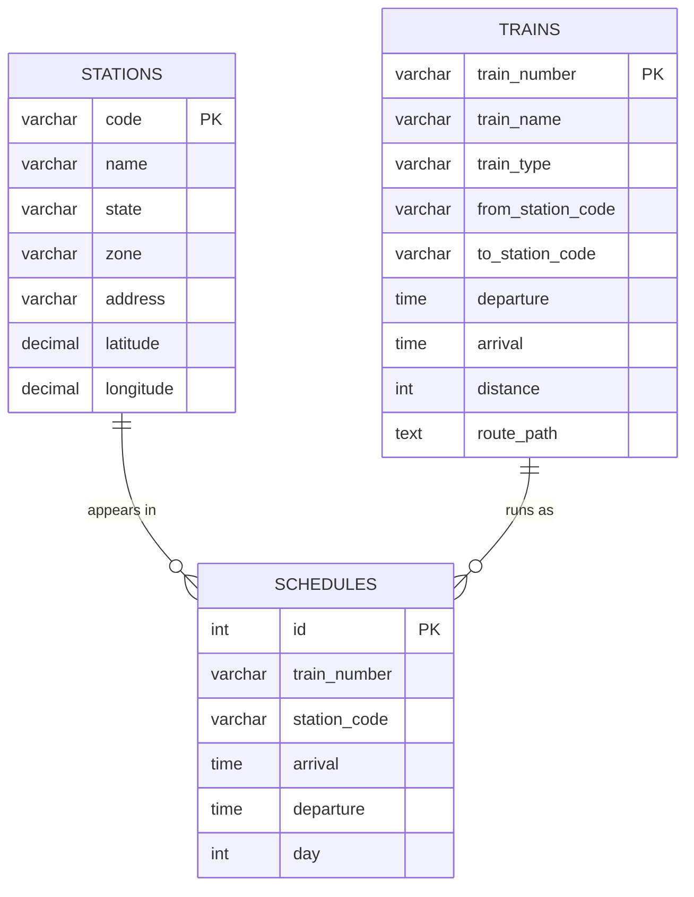

# Indian Railways SQL Optimization


A query-optimization case study on a 430K-row Indian Railways dataset. Seven
slow queries are diagnosed with `EXPLAIN ANALYZE`, fixed with indexes, query
rewrites and a summary table, then measured with a reproducible benchmark.

| Best speedup | Largest time saved | Bulk insert gain | Rows checked |
|:---:|:---:|:---:|:---:|
| **193x** | **6 min → 7 s** | **175x** | **417,080** |
| Deep pagination | Longest halt per train | Against row-by-row autocommit | Full `schedules` table |

Every result is built to be checked:

- **Isolated:** each query starts from primary keys only, so no fix inherits an index from another.
- **Verified:** the benchmark stops with an error if a before/after pair returns different rows.
- **Open:** every query, plan and raw timing is committed to this repo.

## Contents

- [Results](#results)
- [Write-path benchmark](#write-path-benchmark)
- [Network insights](#network-insights)
- [Dataset and schema](#dataset-and-schema)
- [Data quality](#data-quality)
- [Why these queries](#why-these-queries)
- [Limitations](#limitations)
- [Dashboard and presentation](#dashboard-and-presentation)
- [Setup](#setup)
- [Reproducing the results](#reproducing-the-results)
- [Project structure](#project-structure)

## Results


| # | Query | Fix | Before | After | Speedup |
|---|-------|-----|-------:|------:|--------:|
| 1 | Average halt time per station | Covering index on `(station_code, station_name, arrival, departure)` | 1731 ms | 971 ms | 1.8x |
| 2 | Trains through a station in a time window | Composite index on `(station_code, arrival)` | 415 ms | 3.4 ms | **122x** |
| 3 | Longest-halting station per train | Correlated subquery → `RANK()` window function | 360.6 s | 7.4 s | **48x** |
| 4 | Stations served by a Rajdhani or Duronto train | Index on `schedules.train_number` + `JOIN` rewrite | 916 ms | 113 ms | 8.1x |
| 5 | Train lookup by origin station | Index + `SELECT *` → projected columns | 29 ms | 5.1 ms | 5.8x |
| 6 | Deep pagination into `schedules` | `OFFSET 300000` → keyset pagination | 274 ms | 1.4 ms | **193x** |
| 7 | Station traffic dashboard | Summary table simulating a materialized view | 3250 ms | 118 ms | **28x** |

All queries ran on the same MySQL 8.0.37 instance against the full 417,080-row
`schedules` table. Each time is the median of 5 runs on a warm cache, measured
end to end (execution plus fetching the result). Q3's before is the one
exception, explained below.


### Reading the results

- **Q1** reaches 1.8x because it still reads every row. The covering index
  removes the temporary table, not the full scan. Stations with fewer than 20
  timed stops are left out so a couple of long halts can't top the ranking.
- **Q3** runs with `idx_sched_trainnum` in place on both sides. Without that
  index, the correlated subquery would re-scan all 417K rows for each of the
  384K outer rows. Even with it, the before takes about 6 minutes, so that time
  is a single run rather than a median of 5.
- **Q4** gains from the indexes, not the rewrite. Once indexed, `JOIN`, `IN` and
  `EXISTS` land within noise of each other at 113 ms, 107 ms and 106 ms.
- **Q5** bundles two changes, so `SELECT *` was also timed with the index alone.
  The index takes it from 29 ms to 6.8 ms, and selecting fewer columns takes it
  to 5.1 ms.
- **Q6** returns the same 20 rows on both sides. Its cursor is 423375, not
  300000, because ids have gaps. A real client already holds this value as the
  last id of the previous page.
- **Q7**'s after is a 3 ms table read on the server. Most of its 118 ms is
  fetching 7,499 rows into Python. The cost is staleness between refreshes.

### Example: reading the plan for Q6

The plan shows why `OFFSET` is slow. MySQL walks 300,020 rows through the
primary key, then throws away the first 300,000.

```
-> Limit/Offset: 20/300000 row(s)  (cost=21615 rows=20) (actual time=316..316 rows=20 loops=1)
    -> Index scan on schedules using PRIMARY  (cost=21615 rows=300020) (actual time=0.102..289 rows=300020 loops=1)
```

Keyset pagination uses the same index and seeks straight to the first row,
which cuts the scan from 289 ms to 0.03 ms.

```
-> Limit: 20 row(s)  (cost=42644 rows=20) (actual time=0.0209..0.0392 rows=20 loops=1)
    -> Filter: (schedules.id > 423375)  (cost=42644 rows=212829) (actual time=0.0203..0.037 rows=20 loops=1)
        -> Index range scan on schedules using PRIMARY over (423375 < id)  (cost=42644 rows=212829) (actual time=0.0189..0.0336 rows=20 loops=1)
```

The other plans are in [`plans/`](plans/), the queries are in
[`queries/`](queries/), and the raw timings are in
[`benchmark/results.json`](benchmark/results.json).

## Write-path benchmark

`scripts/write_path_bench.py` compares three ways to insert 5,000 rows.


| Strategy | Time | Speedup vs autocommit |
|---|---:|---:|
| Row by row, autocommit | 11,756 ms | 1x |
| Row by row, one transaction | 735 ms | 16x |
| Bulk multi-row `INSERT` (`executemany`) | 67 ms | **175x** |

Autocommit pays for a full commit on every row. One transaction removes that
cost, and a bulk insert also collapses 5,000 round trips into a few multi-row
statements. This is why `sql/load.sql` uses `LOAD DATA INFILE` for the full
417K-row load.

## Network insights

The same data also describes the railway network itself. These queries are in
`scripts/insights.py`, with raw output in
[`benchmark/insights.json`](benchmark/insights.json).

### Chokepoint stations

These stations have the most distinct trains passing through without starting
or ending there, so the most journeys depend on them staying open.


### Schedule consistency

This ranks trains by the standard deviation of their own halts, a proxy for
uneven scheduling. It depends on both halt-time fixes in
[Data quality](#data-quality). The leaders sit at 33–44 minutes and are mostly
passenger and slip-coach services.


### Zone concentration

This measures how much of each zone's traffic runs through its busiest station.
The result is a useful non-finding: across all 17 named zones the highest share
is about 1.6%, a tie between Majorda and Suravali in the small KR zone. No zone
depends heavily on one station by this measure.


### Busiest corridors

These are the station pairs with the most trains running directly between them.
Suburban EMU routes in Chennai and Hyderabad dominate, which is a useful sanity
check: short commuter routes should look different from the long-distance trunk
routes in the chokepoint list.


### Gateway stations

Chokepoints measure volume, while this measures reach. Each station shown is
served by trains from 16 railway zones, the most in the data, so they rank by
distinct trains. Itarsi, Bhopal and Bhusaval are well-known junctions on India's
trunk routes, which suggests the query finds real hubs.


## Dataset and schema

The data comes from a public Indian Railways dataset of stations, trains and
train schedules, published as GeoJSON on Kaggle (mirrors of the datameet/railways
project).


`schedules` is the fact table where almost all the query work happens. It joins
each train to each station it stops at.



These relationships are logical. `schema.sql` declares no foreign keys, because
MySQL would add an index for each one and the baseline has to start with primary
keys only. Every `train_number` and `station_code` in `schedules` does match a
row in `trains` and `stations`.

## Data quality

The source data is scraped and messy, so it needed handling before it could be
loaded.

1. **Nested GeoJSON.** Stations and trains arrive as `FeatureCollection`s, with
   fields inside `properties` and coordinates in `geometry`. `convert.py`
   flattens both into CSVs, splits station coordinates into `latitude` and
   `longitude`, and keeps each train's path as a JSON-text `route_path` column
   for future geospatial work.
2. **Inconsistent nulls.** Missing times appear as JSON `null` and as the string
   `"None"`. Both become SQL `NULL`.
3. **Malformed identifiers.** Some codes are corrupted, such as the station code
   `"YAKUT PUR(YKA"`, and one `return_train` value contains a leaked HTML
   fragment from scraping. These columns are sized generously, from
   `VARCHAR(50)` to `VARCHAR(255)`, so the values are kept as they are rather
   than truncated.
4. **Midnight crossings.** MySQL `TIME` has no date, so a naive
   `TIMESTAMPDIFF(SECOND, arrival, departure)` reads `23:58 → 00:04` as negative.
   Every halt calculation uses `MOD(diff + 86400, 86400)` to correct this (see
   `scripts/db.py`). `NULL` times at a train's first and last stops are expected.
5. **Impossible halt times.** A few stops can't be explained by midnight. Train
   40051 at TBMS arrives at 11:03 and departs at 11:02, which the correction would
   turn into a 23 h 59 min halt. No real halt falls between 8 and 17 hours, so
   anything of 12 hours or more is treated as an error. This excludes 6 of the
   384,107 timed stops and keeps the other 115 stops that cross midnight.

## Why these queries

Each query matches an access pattern this schema would really see, and together
they cover indexing, query rewriting, summary tables and write performance.

| Query | Real-world use |
|---|---|
| Q1 | Reporting on how long trains halt at each station |
| Q2 | A passenger searching for trains through their station this morning |
| Q3 | Per-group ranking, the shape that often becomes a correlated subquery |
| Q4 | A catalog filter, where the real fix is a missing index rather than the `IN` or `JOIN` syntax |
| Q5 | An API endpoint returning train details, where `SELECT *` is an easy cost to overlook |
| Q6 | Any paginated list, since `OFFSET` is what most ORMs generate by default |
| Q7 | A live dashboard recomputing a station summary on every page view |

Two common cases are deliberately left out. Primary-key lookups are already fast
and would show nothing. Full-text train search (`LIKE '%Express%'`) needs a
`FULLTEXT` index or a search engine rather than a B-tree index, so it isn't
benchmarked here.

## Limitations

This project measures the latency of single queries. It is not capacity planning
for a production system.

- **One connection at a time.** Every benchmark is one client on an idle server.
  Lock contention, replication lag and concurrent writers aren't exercised, so
  these are best-case latencies rather than throughput under load.
- **Index write costs aren't measured.** After all seven studies, `schedules` has
  3 secondary indexes and `trains` has 2. Each adds work to every write and uses
  more disk. Schedule data is read far more often than it changes, so favouring
  reads is a reasonable judgment here, though not a benchmarked one.
- **The write benchmark is isolated.** It measures one client loading 5,000 rows
  into an empty table, with no reads running against it.
- **No pooling, replicas or cache.** A production system would likely put Redis or
  a read replica in front of Q1 and Q7 rather than rely on a summary table alone.

## Dashboard and presentation

`frontend/app.py` is a Streamlit dashboard with four tabs: Benchmark Results,
Chokepoint Insights, Write-Path, and Live Lookup. Live Lookup runs Q2 against
MySQL when a connection is available and shows a clear message when it isn't.

```
pip install -r frontend/requirements.txt
streamlit run frontend/app.py
```

`presentation/index.html` is a self-contained slide deck covering the problem,
method, results and insights. Open it in any browser and use the arrow keys or
the Prev and Next buttons.

## Setup

1. Install the dependencies: `pip install -r requirements.txt`
2. Set `MYSQL_PASSWORD` in your environment. `MYSQL_HOST`, `MYSQL_PORT`,
   `MYSQL_USER` and `MYSQL_DATABASE` are also read, and default to `localhost`,
   `3306`, `root` and `indian_railways`.
3. Flatten the raw JSON into `data/*.csv`: `python convert.py`
4. Copy the CSVs into MySQL's `secure_file_priv` folder.
5. Run `sql/schema.sql` to create the unindexed tables.
6. Run `sql/load.sql` to load the data and check row counts. Edit its three file
   paths if your `secure_file_priv` folder isn't the Windows default.

## Reproducing the results

```
python scripts/run_all.py              # all 7 case studies, about 15 minutes
python scripts/insights.py             # network insights
python scripts/write_path_bench.py     # insert benchmark
python scripts/make_chart.py           # benchmark charts
python scripts/make_insight_charts.py  # insight charts
python scripts/make_presentation.py    # slide deck
```

Exact times will vary by machine.

## Project structure

```
railways-sql-optimization/
├── sql/
│   ├── schema.sql              # unindexed table definitions
│   └── load.sql                # loads the CSVs and checks row counts
├── convert.py                  # GeoJSON to flat CSV converter
├── requirements.txt            # dependencies for scripts/
├── queries/                    # query{1-7}_{before,after}.sql
├── plans/                      # EXPLAIN ANALYZE output for each query
├── benchmark/                  # results.json, write_path_results.json, insights.json
├── charts/                     # generated PNG charts
├── frontend/app.py             # Streamlit dashboard
├── presentation/index.html     # self-contained slide deck
└── scripts/
    ├── db.py                   # MySQL connection and shared halt-time SQL
    ├── chart_style.py          # shared chart colors, type and layout
    ├── run_all.py              # runs all 7 case studies end to end
    ├── insights.py             # network insight queries
    ├── write_path_bench.py     # bulk vs row-by-row insert benchmark
    ├── make_chart.py           # benchmark charts
    ├── make_insight_charts.py  # insight charts
    └── make_presentation.py    # builds presentation/index.html
```

## License

MIT. See [LICENSE](LICENSE).
